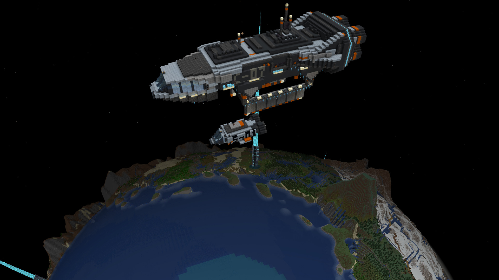

# Starfold

[中文说明](README_zh-CN.md)

A Minecraft 1.21.1 NeoForge mod in which planets are closed, six-faced worlds built from real vanilla chunks. You walk
over a face edge without a teleport or a reload, several planets and suns share one dimension, and you fly between
them without a loading screen, in a ship built with Create and Create Aeronautics or on a thruster pack.



[Starfold on CurseForge](https://www.curseforge.com/minecraft/mc-mods/starfold) · [Escape Velocity survival pack](modpack/README.md) · [Gallery](docs/gallery/README.md)

**Status: alpha.** Single-player is the current testing focus. The `0.4.0-alpha.3` mod update includes revised ship controls, terrain rendering and compatibility fixes for tested Create and Mekanism blocks across rotated planet seams. Back up your world before updating.

## What is in it

- Planets whose terrain, block entities, inventories, collision and simulation are ordinary vanilla chunks. Near
  terrain is loaded the vanilla way, including across face edges; a far view covers what lies beyond view distance.
- Planets of different sizes, with depth scaled to size, caves, ores, biomes and structures.
- Star systems with suns, orbits, spin and day and night, defined in datapacks: see
  [docs/DATAPACKS.md](docs/DATAPACKS.md).
- Space flight for ships built with Create and Create Aeronautics: Starfold adds the ship controller, thrusters,
  booster, gyro, navigation scopes, airstair and aircraft dock. Without those mods, the thruster pack still takes
  you to space on your own.
- Leaving the ground is up to you: build a ship, or craft a thruster pack. The experience world preset also places
  a ready-made starter ship at spawn as a shortcut.
- The eight corners of every planet are fold points that keep players out. The setting behind them is in
  [docs/LORE.md](docs/LORE.md).

## Requirements

| | |
|---|---|
| Minecraft | 1.21.1 |
| Java | 21 |
| NeoForge | 21.1.247 or newer |
| Sable | 2.0.5 or 2.0.6 (required) |
| Create, Create Aeronautics | needed to build ships and for the experience preset |
| Immersive Aircraft | optional; adds an aircraft to the starter ship |

Install `starfold_worlds` for experience planets and presets; optionally add `starfold_extras` for the starter ship, landing pad and guide (requires Worlds, Create and Create Aeronautics).
Match Atlas to the exact Starfold core version. Mining adds ore surveys and extraction equipment. Materials provides lightweight aluminum plating, osmium pressure hulls and ship trim. On CurseForge, Worlds includes Biotech and requires GeckoLib 4.8.2.

Planet rendering needs the vanilla renderer: shader packs are not supported. The mod declares itself incompatible
with `gravity_changer`.

## Playing

For the default flight controls, see [First flight](modpack/README.md#first-flight).

Create a new world and pick a world type:

- `starfold_worlds:experience`: the experience worlds; installing `starfold_extras` adds the starter ship.
- `starfold:native_universe` ("Starfold: Generated Universe"): a generated universe without the pack.
- The remaining `native_*` presets are small setups used in development. They are not listed in the world
  creation screen; a server can select one by id with `level-type`.

`/starfold` holds the planet commands.

## Building

A JDK 21 is required; Gradle is run through the wrapper.

```
./gradlew build                  # jar in build/libs, runs every test
./gradlew packagedContractTest   # checks selected bytecode contracts in the built archives
./gradlew runClient              # development client; its game directory is run/
```

Java sources are formatted with the google-java-format 1.28.0 all-deps jar in its AOSP style
(`--aosp --skip-reflowing-long-strings --skip-javadoc-formatting`). The formatter is supplied locally;
the script verifies its SHA-256 and never downloads tools:

```
python3 tools/format-java.py --formatter /path/to/google-java-format-1.28.0-all-deps.jar
python3 tools/format-java.py --formatter /path/to/google-java-format-1.28.0-all-deps.jar --apply
./gradlew formatCheck -PjavaFormatterJar=/path/to/google-java-format-1.28.0-all-deps.jar
```

The first command checks tracked and newly added Java sources without rewriting them. Mixin contracts
enumerate the registered mixins and require an explicit audit decision for each; generic selector checks
and dedicated semantic checks have different scopes.

Optional mods for the development client go in `run/mods`, which is not versioned. Tests that check item ids of
those mods skip that check when the directory is absent.

## Repository layout

- `src/main`, `src/test`: the core `starfold` mod and its tests. The code is in `dev.starfold`, one package per subsystem
  (a test sits in the package of what it tests):
  - `geometry`: the cube surface, its faces and seams, as plain maths with no Minecraft types.
  - `network`: shared payload registration and dist-safe receivers.
  - `chart`: planet shapes, celestial orbit and sun computations, and how an observer sees a planet from ground to orbit.
  - `planet`: planet storage and identity, the core and fold-point geometry, and the pure flight dynamics kernel.
  - `worldgen`: the terrain algorithms: height, rock, caves, minerals, biomes and decoration.
  - `universe`: what a datapack defines (planet types, star systems, universe layouts), the generated universe
    and the chunk generators that save a system with its world.
  - `sky`: saved celestial motion, the clock, daylight and weather.
  - `ground`: the server side of living on a face: seams, chunk views, observer and flight payloads, light and lifecycle hooks.
  - `render`: the client's far view of the planet, terrain display transitions and the shader patches.
  - `flight`: personal flight, its HUD, the permit other mods can grant and fold-point player effects.
  - `space`: the region between planets.
  - `ship`: Sable hulls: helm, thrusters, fuel, landing, airstair, dock, pressure damage and saved ship records.
  - `waypoint`: marks and navigation to them.
  - `api`: survey and system-map access for client modules.
  - `storage`: shared chunk-address keys.
  - `mixin`: core mixins.
- The subprojects in `settings.gradle` each keep code/resources in `<module>/src/main` and tests in
  `<module>/src/test` where present:

  | Module | Responsibility and source path |
  |---|---|
  | `atlas` | Planet surveys and galaxy/system/ground maps: `atlas/src/main/java/dev/starfold/atlas` |
  | `monsoon` | Client seasonal snow and vegetation rendering: `monsoon/src/main/java/dev/starfold/monsoon`; Ecliptic Seasons adaptations are pending release clearance |
  | `devtools` | Opt-in client CPU/GPU profiling: `devtools/src/main/java/dev/starfold/devtools` |
  | `probes` | Development probes, passive measurements and probe mixins: `probes/src/main/java/dev/starfold/{dev,probe,probes}`; development only |
  | `worlds` | Experience planets, biomes and world presets: `worlds/src/main/java/dev/starfold/worlds` and `worlds/src/main/resources` |
  | `extras` | Optional starter ship, landing pad and guide: `extras/src/main/java/dev/starfold/extras`; ship structures in `extras/src/main/resources/data/starfold_extras/structure` |
  | `mining` | Ore surveys, waypoint integration and extraction equipment: `mining/src/main/java/dev/starfold/mining` |
  | `materials` | Aluminum stock, hull plating and pressure hull components: `materials/src/main/java/dev/starfold/materials` and `materials/src/main/resources` |
  | `biotech` | Flesh hive terrain, organic materials and the Host encounter: `biotech/src/main/java/dev/starfold/biotech` and `biotech/src/main/resources` |

- `docs/DATAPACKS.md`: the reference for datapack authors, also in Chinese; tests read its examples.
- `docs/ROADMAP.md`: what is planned and how far it has been thought through, also in Chinese.
- `tools/ship`: generators for the starter ship structures and block resources.
- `tools/probe`: scripted in-game checks for the development client, see [tools/probe/README.md](tools/probe/README.md).
  The launch scripts are written for the maintainer's Linux setup.
- `tools/rename_project.py`: renames the project (ids, packages, paths) in one run from `project-names.json`.

Earlier prototypes and their release notes are kept on the `archive/*` branches.

## License

MIT, see [LICENSE](LICENSE).
