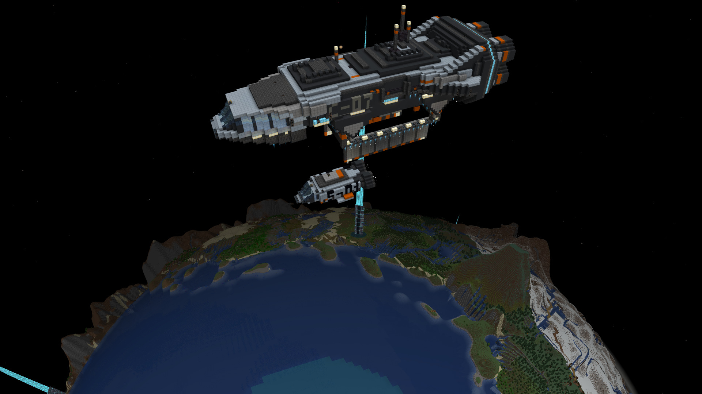

# Starfold and Escape Velocity gallery

The cover and stills come from the Escape Velocity trailer and its filming assets. The C-07 carrier and S-01 shuttle are demonstration builds and optional construction schematics.

| Image | Scene |
|---|---|
| [Hearth from orbit](hearth-from-orbit.jpg) | The home planet's oceans, continents and polar terrain from space. |
| [Hearth shipyard](hearth-shipyard.jpg) | C-07 at a runway on Hearth. |
| [Carrier over Fleck](carrier-over-fleck.jpg) | C-07 above the rocky moon. |
| [Shuttle on Fleck](shuttle-on-fleck.jpg) | S-01 on the surface beside an anomaly. |
| [Flesh and the Host](flesh-host.jpg) | The Host encounter on the Flesh moon. |
| [Atlas globe](atlas-globe.jpg) | The English Atlas globe with the tracked carrier and shuttle. |
