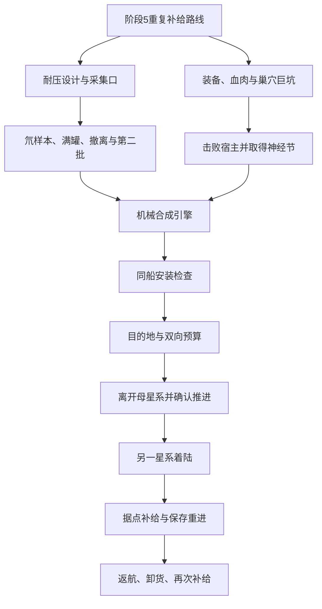

# 采气、宿主与首次星际远征参考

阶段6–7开发交付，2026-11-11。本文按当前源码、固定版本配方和数据编写；新增任务均区分物品检查、战斗事件与手动记录。本轮没有进行游戏验收，也没有打开既有普通生存存档。

## 两路准备，在引擎前汇合

阶段5的重复补给路线完成后，可以先采气，也可以先挑战宿主。采气路线不再被宿主击杀阻塞，宿主路线不依赖采气。制造引擎同时需要撤离复采记录、击杀记录和神经节物品；取得引擎后另做同船安装检查。原有任务、子任务与奖励ID保持不变。

通用钢材、铁块、精英电路样本和终极储罐任务为可选备料提示，不用任意库存样本阻塞两条主线。实际配方材料、装船质量和兼容储罐仍必须准备；“可选”不免除配方成本。



## 采气设备与风险

采集口普通有序配方消耗1精密构件、2高级电路、1 Create 流体储罐和1旋转冷凝器。另备接收产出的空流体储罐，不把配方中已消耗的储罐当作装船容量。化学罐不是推进燃料罐。先在安全区域核对同船识别、可填入氘和推进抽取兼容性。

采集口在已组装的 Sable 船体上、空间区域内按服务器游戏tick被动工作，不要求单独红石驱动；输出到同船兼容流体处理器。没有符合条件的储存、储罐已满或流体不兼容时，未接收的整数产量会丢弃，不积攒成以后突然释放的大批流体。

当前氘定义为 `rate=10`，产率为 `10 × 采集口压力 / 0.5 mB/tick`。例如压力0.25的理想产率为5mB/tick，即20TPS下100mB/s；这一换算未计飞行进出、服务端降速、损伤、罐满及输送限制，不能据此承诺一次航行的实际产量。低于0.5仍可产出，不必为了参考产率冲到普通部件损坏阈值。

| 部件 | 完整方块质量 | 开始受压损坏的阈值 |
| --- | ---: | ---: |
| 默认普通方块，包括未另配耐压的设备 | 按各自质量分类 | 压力≥0.5 |
| 铝轻质板 | 0.5 | 压力≥0.5 |
| 锇耐压壳 | 4 | 压力≥0.85 |

耐压壳配方为5锇锭+4铁锭→4块；半砖半质量，双半砖恢复完整质量。耐压按实际方块判定，包一层耐压壳不会给采集口、油罐、喷口或驾驶设备授予整舰护盾。船体最深处的压力可能大于采集口压力；以最弱部件和最大暴露为撤离依据，保留余量，不把恰好等于阈值视作安全。玩家压力读数和船壳损伤也不能混为同一项认证。

在 Amber 外侧先演练进场、反向推进和撤离，记录进入前后各罐液位、质量、压力与损伤。满8000mB的旧任务保留为储存记录，不能证明远征储备足够；满罐还会增加质量。另登记第二批和安全撤离。保留普通燃料供母星系内撤离，并将制造用1桶氘与飞行储备分开。

重水分离产氘路线在整合包中移除。旋转转换处理已有氘，不构成绕过采气的从零产氘来源。样本桶的物品任务不证明产地，采气记录需保留截图或服务器回执。

生存取样使用注液器：预留至少1000mB已采集的流体氘，经兼容流体管道和朝向正确、已供动力的机械泵送入 Create 注液器（Spout），将空桶放在其下的置物台或传送带上，灌装后收取氘桶。普通 Create 储罐在当前固定版本中不提供生存右键装桶交互；可以把灌装站设在制造基地。返还样本时也须走兼容的流体转移路径并核对实际液位，不能把空桶返还当作氘返还。管路、船体流体接口和完整灌装站仍需实际验证。


## 后续设计：采气控制与船载 HUD

- **用信号启停采气。** 让玩家通过船上的控制信号决定采集口何时开始和停止工作。气层压力仍决定是否有气可采及实际产率。信号类型、未接线时的默认行为及旧船兼容方式待定。
- **把设备读数接到驾驶界面。** 让玩家通过管线或电线，将选定的船载传感器和设备接到控制屏，由控制屏把配置好的信息显示在驾驶 HUD 上。可接入的来源包括速度传感器、引擎运行状态、燃料罐液位和摄像头画面。玩家可以选择接哪台设备、显示哪些读数或画面。
- **采气作为使用场景。** 驾驶员从控制台发出启停信号，并在 HUD 上查看采集口状态、气层压力和储罐液位，判断何时结束采集并撤离。具体接线和 HUD 布局留待设计。

## 宿主与引擎制造

血肉是 Amber 的外侧卫星。按 Atlas 中当前实际标识定位，记录着陆点和巢穴巨坑外的撤退路线，停泊船与战斗路线分开。护甲、远程武器、弹药、食物、恢复物资和维修件为战斗准备；任务里的数量不是装备充分或必胜证明。

每颗具备巢穴的星球各自记录自然宿主遭遇。击败后等待七个游戏日，再接近同一巢坑可重新挑战。冷却按世界运行时间累计，重进或睡过夜不会跳过。若宿主实体遗失，回到巢穴且其最后所在区块已完成实体载入后，开始相同的恢复冷却。每次固定产出四个神经节，每台引擎消耗一个。

宿主击杀任务记录玩家战斗事件，神经节任务记录物品持有，两者不同。神经节用于配方，不另设驾驶员boss许可开关；其他玩家制造的合规引擎也不因驾驶员未亲自击杀而失去硬件资格。战斗死亡、遗失和救援沿用存档规则，不在本阶段改变。

接近巢穴巨坑会触发首次自然遭遇，单纯到达血肉不等于生成宿主。优先处理囊体：地面阶段仍有囊体时宿主只承受正常伤害的10%；囊体清空或生命严格低于一半会进入第二阶段。当前配置尝试生成6个囊体，准备阶段转换后的撤退空间。

当前星际引擎使用 Create 机械合成，排布如下，不是3×3工作台配方：

```text
H C H
C D C
H C H
  G
```

H=锇耐压壳，共4；C=精英控制电路，共4；D=氘桶1；G=宿主神经节1。需要3列×4行范围内10个机械合成器，正面朝向一致，箭头可按下图让两侧汇入中列、中列向下，最终从底部中心输出。给阵列供给旋转动力，并在最终输出端接住引擎与空桶。若使用完整12格阵列，底部两个空角须加合成器盖，不能填额外材料。配方不接受镜像，保持图示朝向。以下是根据固定版本代码推导的搭建示例，完整设施仍待实机核验。

```text
H→ C↓ H←
C→ D↓ C←
H→ C↓ H←
   G↓
   输出
```

另留传动和制造失败后的维修预算。

配方里的四块耐压壳消耗5锇+4铁；它们会随合成被消耗，装船耐压壳须另备。高级/精英电路继续按当前 JEI 的实际路线加工，不能只沿用旧基础电路库存数量。制造桶与飞行罐分别计量。按固定 Mekanism/Create 容器与合成逻辑，成功后应输出1个引擎和1个空桶，空桶汇入合成输出流，不保证留在原输入格；实际配方执行与两种输出的收集仍待实机核对。

## 同船推进门槛

引擎必须安装在推进器与可抽取燃料罐所属的同一船体，持有物品不算安装。边界由船在宇宙中的位置相对母星系中心与范围判断，不由某个固定星球编号或玩家手动任务状态判断。

| 航段 | 允许的配置燃料 | 引擎要求 |
| --- | --- | --- |
| 母星系内 | 柴油、汽油、液氢、氘 | 普通推进不要求星际引擎 |
| 母星系外，要求推进或制动 | 氘等被标记为 `interstellar` 的燃料 | 同船安装星际引擎 |
| 惯性滑行 | 不发生推进消耗 | 门槛不禁止滑行；之后刹停仍须合格配置 |

当前氘冲量23500、柴油940、液氢1880，均为每1000mB质量47；氘冲量为柴油25倍。冲量不提高单个喷口3350的额定推力，不能让超重船起飞。普通燃料留在船上仍计质量，出了母星系不能靠普通燃料刹停。“抵达另一星系”也不自动恢复普通燃料资格，门槛仍以是否在母星系范围内判断。

## 实际目的地与远征目标

Worlds 的 `experience` 宇宙当前配置母星系之外的8颗额外恒星（当前配置新建世界共9颗太阳），其他星系生成2–3颗行星，星间布局参数 `star_gap=5200000`。具名起步星系和其行星不代表整个宇宙只有一颗太阳。Biotech 扩充类型列表；KubeJS 不覆盖宇宙定义。布局参数不是当前航程距离，具体恒星、行星编号、资源与可用航路须在加载的世界中查看，不编造固定远征坐标。

第一轮远征目标明确为：选择实际另一星系→在其中一颗可着陆星球安全着陆→建立有补给的据点→保存重进保持可用→原船返航卸货并准备下一次补给。开放探索仍可继续，无须遍访全部世界、建设反应堆或依赖随机战利品。新星系不承诺母星系没有的独占矿、新科技树或新增结构。

Atlas 单击选中天体后，使用“设为导航目标”发送导航请求；双击“接近”只移动星图镜头，不驱动飞船，也不代替设置目标。先选恒星系，使用“查看恒星系”，再查看并选择实际着陆星球。太空导航须在相关船体驾驶台操作，并装有二级导航瞄准镜或三级精确瞄准镜；基础一级瞄准镜不足。设置后确认导航实际生效，客户端选中标识不代表服务端接受。导航要分清恒星目标与着陆星球目标；接近时按目标相对速度制动。保留来向、基地标记、着陆点与船体UUID。离开驾驶台前停稳、登记停泊点并检查登船路线。地图历史与任务手动勾选都不是实时货物/燃料遥测。

## 逐段预算与救援

`tools/ship/round_trip_budget.py --plan plan.json` 支持氘，并可在根对象声明 `drive_installed`，在每航段声明 `outside_home_system`。未填视为母星系内/未安装；必须按实际航段填写，工具不会从距离推断星系边界。母星系外正Δv航段若缺少引擎或燃料资格，会在该段前停止，保留未消耗燃料。零Δv仅表示本模型不请求推进，不能证明能安全完成滑行抵达。

仓库提供[纯合成输入示例](../examples/interstellar-budget.json)，可运行 `python3 tools/ship/round_trip_budget.py --plan docs/examples/interstellar-budget.json`。其中500干质量、8000mB初始氘、4000mB储备、每段1000理想Δv及20新增质量均为演示数字，不对应实测船型或真实航线。没有填写有效重力，因此此例不检查升力。

依次输入去程加速、巡航修正、目标制动、着陆、返程起飞与返程制动的理想Δv需求。重力损失、阻力、操纵和着陆消耗需由调用方另外估计或实测；工具不会从星间距离估算这些需求。每段的新增物理质量会保留到后续段，储备始终留在船上、不参与可消耗量。可显式填写有效重力与升力喷口进行静态起飞核算。单次计划使用一种燃料，不模拟多燃料混烧或沿途补油。

按实测干质量和各罐读数起算，不用旧参考船质量替代耐压改装后的船。升力、制动和返程单列，不能把近地短飞耗油或理想总Δv当作已认证路线。若途中补油，保留独立记录后用新液位重新规划；不要向不支持补油的六事件采锇日志硬塞一条虚假连续航程。

据点至少有照明住所、仓储、食物、工具、维修件与已送达兼容燃料，另选一个当地资源运输或建设目标。未验证当地可产氘，不能承诺据点自给。返航储备不足时停泊，安排送氘或具备星际资格的救援船；普通燃料救援船不能指望在边界外持续推进。记录换船、人员与货物转移，保存可恢复路线。

## 当前验证边界

本轮交付的是双语任务图、材料/风险说明、离线预算和检查，未进行采气飞行、宿主挑战、引擎机械合成或星际往返游戏验收。手动记录要求实际观察，但勾选本身不证明它已经发生。既有阶段3–4的供给夹具局部短飞，不覆盖氘、压力、宿主、星际边界、长途操纵或新星系据点。任何后续游戏验收均须单独获得明确授权。
