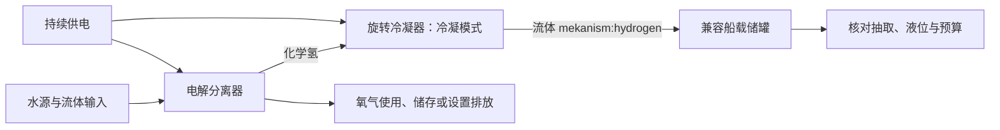

# 阶段5参考：液氢、轻量运输与补给路线

本页交付生产和运输教学，不认定完整工业线或资源往返已经实测。本轮仅做离线开发与检查；阶段4的两块电路、单份原锇装卸和柴油局部飞行不能替代本阶段验收。

## 从锇启动到液氢

先完成阶段4的基地卸矿，再扩大工厂。已有热力发电机、灌注机与两块基础电路只是启动设备；不保证单台启动电源足以连续运行电解与冷凝。



固定版本配方中，2单位水产生2单位化学氢和1单位氧气；氢的旋转转换为1:1。化学氢使用化学管路，液氢使用流体管路，二者不能互换。冷凝器必须选择化学输入→流体输出方向，并配置对应的输入、输出和电力端口。供料用化学储罐、出料用流体储罐；机器合成消耗的罐子不会作为可用的外部缓存保留下来。氧气满罐会阻塞电解，不能只连氢出口就假定能持续运行。具体配方和静态配置审计见仓库 `build/stage5/hydrogen-audit.md`；游戏中以当前 JEI、机器模式、侧面配置和实际读数为准。

先收取一批液氢，记录机器、供电、输入/输出与船罐液位；将该批分开收纳后再生产、收取第二批。核对水、化学氢、液氢和残留量的平衡。确认船罐允许实际抽取，不能用高级罐物品或一桶样本代替输送能力证明。初期建议把加工留在母星，船上只带燃料与货物；移动工厂另计设备质量和供电。

## 材料与启动依赖

除阶段4的启动套件，还需要粉末加工、灌注合金、电解核心与冷凝器。当前灌注合金使用**铜**和红石灌注材料，不是铁。保留一部分原矿用于富集：配方允许3份原锇→4份锇粉；全数冶炼会让粉末加工路线变长。分离器需要锇粉、铁粉与金粉，不能把机器的锇总量当成全部工厂成本。

阶段4静态审计的“热力发电机+灌注机+富集仓+分离器+冷凝器”经本轮重新核对后合计11锇锭与2锇粉，（旋转冷凝器用两块基础电路，共6锇锭；旧阶段4审计少计一块电路），仅是这五台设备的锇用量；供水、能源、管线、储罐、工具和运行耗材另备。不将8份原锇启动门槛改写为完整液氢工厂预算。材料逐项扩展及运行功率另见上述审计。

精密观察镜配方是导航镜+2块高级控制电路+2块萤石。获取两块高级电路并不等于还留有两块可用于后续采气口，安装前按用途分别留料。锡、铅、铀、远古残骸、钢制多用工具和高级流体罐都是按具体用途选择；核能、随机结构与所有资源星巡礼均不设为主线前提。

### 阶段4设备保留时的增量备料

以已有热力发电机、灌注机和**两块未消耗基础电路**为起点，两块电路用于富集仓，再另制两块给冷凝器。新增富集仓、分离器与冷凝器的材料如下，不含管线、外部罐、泵、电源扩建与运行耗材：

| 增量原料 | 数量 |
| --- | ---: |
| 锇锭、锇粉 | 7锭+2粉 |
| 铁锭、钢锭、铁粉 | 10锭+4钢锭+1粉 |
| 金锭、金粉 | 3锭+1粉 |
| 铜锭 | 9 |
| 便宜玻璃方块 | 8 |
| 红石 | 31普通粉，或18直接用粉+2粉先富集 |

两条红石路线二选一。已有两块电路先造富集仓，再富集红石，不存在先造新电路的循环。无钢材时另备4铁锭及80碳灌注量（8煤或4木炭），再冶炼；发电和熔炼燃料另计。原矿粉末3→4的批次有取整和余料，不能将“2粉”直接当作只采2份原矿。

冷凝器新放置默认即化学→流体，但其**左侧化学端口默认输出**，直接往左灌氢会被拒绝；改成输入或用其他化学输入侧。流体默认右侧输出。方向均相对机器朝向。热力发电机的电力输出在正面，不能把热传导接口当成电力连接。具体布局仍需实际验收。

基础无升级数据中，分离器每次耗400J产2氢，冷凝器每次耗50J产1mB液氢；一台冷凝器最大20mB/s，对应理想匹配负载250J/t。1000mB批次理想耗250000J、用时至少50秒，另有缓冲、启动、供水和供电损失。热力发电机配置的200是燃烧热输入，不是保证200J/t电力；只能由读数判断持续功率。可扩大发电、缓冲或接受间歇慢速批产，不宣称单台启动电源满足产线。

## 保持布局，量化升级

参考 B6-F 的185个方块中有136块圆石。把这136块替换为完整铝轻质板，保留喷口、设备、甲板和出入口：圆石质量按固定 Sable 类别为2，完整板质量由 Materials 配置为0.5，静态减重204。以当前参考干质量323.5作说明，替换后的模型干质量119.5；这是静态计算，实际组装后重新读取质量与质心。旧柴油船的局部飞行验收不自动继承给轻量船。

八铝锭制造四块完整板，因此完整替换需要272铝锭；任务中的四块只是材料样本。可分批对称替换、逐次测量，不要求一次整舰换材。减重会改变惯量与操纵，维持连接、设备供油和安全上下船；不据此承诺可载多少组矿石。当前货物是否被质量系统计入必须观察，离线工具的 cargo mass 是明确输入的模型质量。

液氢每mB冲量1880，柴油/汽油940；三者配置质量均为47/1000mB。因此相同体积液氢没有更轻，但理想可用冲量更高。其收益不能写成“三桶入轨”或真实航程。轻质板默认耐压阈值仍为0.5，不用于认证气态星深潜。

离线比较使用 `tools/ship/upgrade_comparison.py`，单段预算使用 `flight_budget.py`，多段使用 `round_trip_budget.py`。必须显式填写干质量、货物模型、实际有效重力、喷口、燃料与保留量。悬停时间和理想真空Δv是同一份燃料的不同用法，不能相加。路线预算还需重力损失、转向、上升、制动和停泊余量。

下面命令使用**人为指定的有效重力10**、空货物模型、总燃料4000mB、保留50%与两个升力喷口；不是推荐航线参数：

```sh
python3 tools/ship/upgrade_comparison.py --gravity 10 --fuel-mb 4000 \
  --cargo-mass 0 --reserve-fraction 0.5 --lift-nozzles 2
```

| 相同体积比较 | 湿质量 | 静态推重比 | 理想真空Δv |
| --- | ---: | ---: | ---: |
| 原布局+柴油 | 511.5 | 1.310 | 4061.26 |
| 换板+柴油 | 307.5 | 2.179 | 7296.77 |
| 换板+液氢 | 307.5 | 2.179 | 14593.53 |

数值按游戏一致质量/速度单位输出。用实际装配后干质量可追加 `--baseline-dry-mass`；其余未建模质量仍须自行明确。工具读取当前燃料及本地 Sable 分类 JSON，并在输出披露简化假设；它不是完整运行时方块属性解析器。

## 选择一条能维持的资源路线

| 当前需求 | 资源类型 | 回基地后的用途与边界 |
| --- | --- | --- |
| 扩建机器 | 岩质星或小行星锇 | 补充设备材料与粉末，不保证某个固定坐标 |
| 减重 | 沙漠星铝土矿 | 冶炼、制作板材，分批替换并称重 |
| 精密镜 | 晶体星萤石 | 两块进入镜配方，另备高级电路 |
| 特定设备 | 冰冻星锡铅、沙漠铀等 | 先查配方再采集，不为任务清单盲目巡航 |

Atlas 中选择当前目标和着陆点，不照抄其他存档的星球编号。每条路线登记基地与前哨标记、停泊地点、船体UUID、各罐液位、货物装卸、耗时和工具损耗。前哨至少备食物、照明、适用工具、备用船壳和兼容燃料；供油不足时保持停泊，安排送油或救援。母星保留备用维修与供油能力，不以死亡返程或替换船体充当同船完成。

完成两次分别记录的交付后，再填写任务的手动路线记录。可用 `voyage_log.py` 分别核对每次申报的一致性；它不证明矿物来源，当前严格格式也不支持途中加油，需单独保留补给记录，不能把加油量伪装为负消耗。一般资源路线可以按同样字段人工登记，该工具的现有规则仅适配原锇航次。

## 验收边界

本次已提供配方审计、模型和双语任务。实际持续产液氢、跨模组端口输送、轻量船操纵及两次真实资源交付仍须另行授权的阶段内关键点验收。结构内容暂保留探索方向，不新增随机战利品门槛，也不把未选定结构写成已接入。
