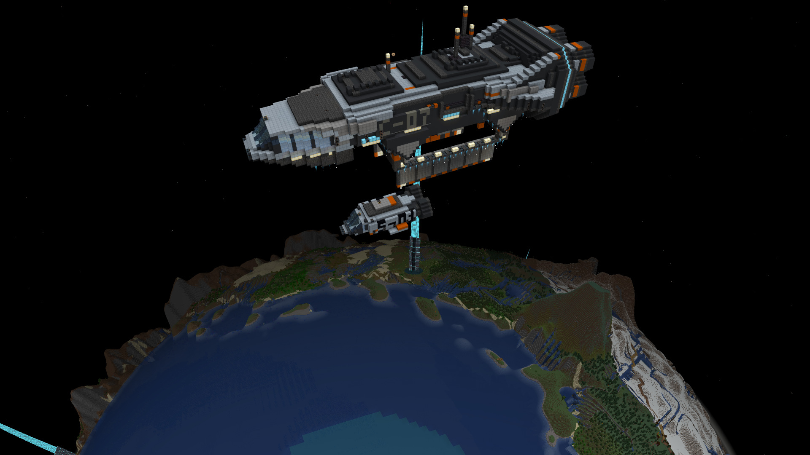

# Starfold Escape Velocity



[Install on CurseForge](https://www.curseforge.com/minecraft/modpacks/starfold-escape-velocity) · [Gallery](../docs/gallery/README.md) · [中文玩家手册](../docs/escape-velocity-player-guide_zh-CN.md)

Start from scratch on Hearth. Build a Create workshop and a fuel supply, assemble a ship with Create Aeronautics, and use Atlas to plan off-world resource trips. Later quests lead into gas collection, the Host encounter and interstellar travel. C-07 and S-01 are buildable schematics for players who want a carrier and shuttle project.

Install from CurseForge using Java 21. In a fresh single-player world, select **Starfold: Experience**, then open the starting guide and FTB Quests. Pack `0.4.0-alpha.3` targets Minecraft 1.21.1 and NeoForge 21.1.247. Select **Beta** in the CurseForge file list to find this version.

## First flight

Right-click the helm of an assembled ship to take control. Check that all six thrust directions work, the gyros have power, and the fuel tanks feed the thrusters. Practice takeoff and landing with a light load before carrying ore.

| Default input | While piloting |
| --- | --- |
| `W/S`, `A/D`, `Space/Shift` | Move forward/back, strafe and climb/descend. |
| Mouse, `Q/E` | Steer. `Q/E` banks near the ground and rolls in space. |
| `Ctrl` + movement | Boost. `Space + Ctrl` cancels automatic arrival when active. |
| `F5`, hold left `Alt` | Cycle views or look around. Scroll to zoom in chase view. |
| `M`, `F`, `G` | Open Atlas, lock or clear the aimed-at space target, or cycle space targets. Target locking requires a tier-2 or tier-3 scope. |
| `R` | Leave the helm after landing and settling. |

Use Atlas's **Set navigation target** while piloting to send a destination to the ship. Watch relative speed and distance and leave room to brake before descent. The [Chinese player guide](../docs/escape-velocity-player-guide_zh-CN.md) covers assembly, fuel, the first osmium haul and the full interstellar route.

Fission reactors, fusion reactors, industrial turbines and their dedicated parts have their crafting recipes deferred in `0.4.0-alpha.3`. Uranium and deuterium remain available, including Amber's deuterium collection for the interstellar drive.

## Building from source

Minecraft 1.21.1 / NeoForge 21.1.247. Run packwiz commands **inside this directory**:

```sh
nix run nixpkgs#packwiz -- refresh
nix run nixpkgs#packwiz -- list
```

Build and export from the repository root:

```sh
./gradlew :jar :worlds:jar :atlas:jar :materials:jar :mining:jar :biotech:jar
python3 tools/modpack/export-local.py --side client --output build/pi/escape-velocity-client.zip
python3 tools/modpack/export-local.py --side server --output build/pi/escape-velocity-server.zip
```

The client ZIP is a CurseForge-format import. For a dedicated server, resolve the
pinned project and file IDs from the server ZIP's `manifest.json` into `mods/`,
then copy the contents of `overrides/` into the server root. Use NeoForge 21.1.247
and set `level-type=starfold_worlds:experience` before creating the world.
The export runs locally. Third-party JARs are resolved at installation time.
To deliberately upgrade one, use `packwiz unpin <slug>`, `packwiz update <slug>`,
inspect its dependency ranges and changes, then `packwiz pin <slug>` and `packwiz refresh`.
Do not blanket-update: Create 6.0.10, Aeronautics **bundled** 1.3.2, Sable 2.0.5,
and Immersive Aircraft 1.5.2 are the tested integration targets. Aeronautics bundles
Aeronautics/Offroad/Simulated, **not Sable**; Sable is a separate pinned dependency.
Crafts & Additions 1.6.0 declares Create `[6.0.7,6.1.0)`.
JEI 19.70.0.460 declares MC `[1.21,1.21.1)`. This is accepted by the bundled FML
4.0.43 compatibility matrix, which lets MC 1.21.1 satisfy 1.21 constraints; do not
patch third-party jars or mistake that range alone for an incompatibility.
MezzConfig is JEI's CurseForge dependency (also embedded at an older version).

The [stage-six/seven reference](../docs/modpack-design/gas-and-interstellar-reference.md)
opens gas collection and Host preparation in parallel and joins them at drive
fabrication. New manual records cover withdrawal/recollection, installation,
expedition planning, another-system landing, outpost save/rejoin and return.
Generic late-game stock samples are optional; actual recipe costs remain.
The experience universe defines eight additional stars beyond the one-sun home system
(nine suns in a newly generated current layout); the named starter system is only
the home system. The sequential planner accepts deuterium and explicit drive /
outside-home declarations, without route or gameplay certification. Bounded tests with prepared fixtures covered gas collection, deuterium bottling and interstellar-drive crafting. The Host encounter, outbound propulsion, landing and return remain open in those tests.


## C-07 and S-01 construction schematics

Use Create's Schematic Table with an Empty Schematic to select `s01.nbt` or the C-07 files. Each C-07 hull section can be assigned to its own Schematicannon. `schematics/ship-schematics.json` lists the offsets from a shared shipyard origin and the block counts. Keep the supplied west-facing orientation for both ships. Use the listed offsets to align all C-07 sections and doors. Use the keep-existing-solid-blocks setting and supply materials and gunpowder to each cannon. Print in a clear berth. After a server restart, check each cannon and press Play if it says Ready. Before assembly, check both gyros in each hull. Re-place the adjacent redstone block if a printed gyro remains unpowered. Physical assembly, door hinges, and docking are separate steps.

## Starfold modules in the pack

The CurseForge release pins five downloadable files: Starfold, Atlas, Mining, Materials and Worlds with Biotech. Source-based client and server exports bundle the following six individually built JARs under `overrides/mods/`:

- `starfold-<version>.jar` (core)
- `starfold_worlds-<version>.jar` (experience planets and presets; the pack's
  `starfold_worlds` data overrides need it)
- `starfold_atlas-<version>.jar` (planet, system and interstellar maps, ship tracking)
- `starfold_materials-<version>.jar` (aluminum stock, lightweight panels and osmium pressure hulls)
- `starfold_mining-<version>.jar` (stage-one fuel/FE mining platform and discovered-site surveys)
- `starfold_biotech-<version>.jar` (Flesh and the Host encounter; requires exactly GeckoLib 4.8.2)

GeckoLib is pinned to CurseForge file **7023453**, `geckolib-neoforge-1.21.1-4.8.2.jar`.
Biotech appends Flesh to the experience system and universe; KubeJS does not override these definitions.

`starfold_extras` is not needed: this pack starts from scratch, without a supplied ship or landing pad.
`starfold_probes` is development-only and never goes into the pack. Drop all six into **the test instance's `mods/` directory** alongside the resolved CurseForge
mods, then copy `kubejs/` and `config/` into the instance root. For a source-based local test, `modpack/mods/` can still hold these jars temporarily. The local exporter bundles the six built jars and uses the pinned CurseForge file IDs for external dependencies. Never upload a development zip as a complete pack.
Do not put zero-byte jars or invented CurseForge metadata here.

## Rules and verification

`RULES.md` records the current resource and progression rules; `ids.json` records evidence for IDs.
Run the maintained tools from the repository root:

```sh
python3 tools/modpack/check-modpack.py
python3 tools/modpack/generate-quests.py --check
```

The checker defaults to source-only checks. `--with-jars` additionally checks pinned
archives already in `build/pi/jars`; it never downloads. Inventory uses that cache
by default: `python3 tools/modpack/inventory.py`; `--fetch` explicitly permits
missing downloads. Its default output is `build/modpack/ids.json`; updating
`modpack/ids.json` requires `--output modpack/ids.json`. Quest generation requires
`--output <directory>` or `--check` (temporary generation and byte comparison).
`python3 tools/modpack/refresh-index.py` rebuilds the complete runtime index and
pack hash after resource or pin changes. File-preservation regression checks run
with `python3 tools/modpack/test_prepare_runtime.py`. For isolated source-based
survival runs, `python3 tools/modpack/prepare-runtime.py` verifies cached pinned jars and stages
`build/survival-stage1/instance`; Gradle `-PsurvivalPack` uses that directory and
excludes Extras. It preserves saves, options and existing server properties,
updating only managed config/KubeJS files. New server properties bind to IPv4
loopback on port 25576; clients use `-PdevProbePort=25576` and may select a test
identity with `-PdevProbeUsername=<name>`. Stop games before staging updates.
The regular `run/` development instance is separate.

No downloaded jar is executed during source preparation. Static checks do not establish
in-game compatibility, progression balance, oil-field generation or boss spawning.

The preset overrides the experience preset to omit `starter_ship`, the Nether and the End (portals lead nowhere, so resources stay tied to planet classes); a normal-preset tag
selects it first in new-world creation. Existing saves are not migrated. Use a new world.
Balance values in JS/quest files have first-guess comments; JSON balance notes are in
`kubejs/BALANCE.md` (JSON cannot contain comments).

## Preliminary playability status

The observations below are historical, pre-cleanup playability notes. They are not
current acceptance receipts; current source contracts are checked by the tools above.
The pack is **not yet accepted through survival stages 0–5**. A fresh survival spawn,
local base ores, disabled Nether/End, Chinese quest progress, and diesel-powered
small-hull flight were observed; this was a command-built fixture, not a survival
round trip. Nether-free Blaze Burner and Rose Quartz recipes remove known bootstrap
deadlocks. Round 2 restored client startup with the test instance's early window disabled.
A grounded mass-24.5 fixture earned lift-off/space records, used ~5.9–6.0 diesel
buckets at impulse=2, and stopped accelerating after fuel exhaustion. The historical repeat at diesel impulse 1.55 measured **7.55–7.59 buckets** to
space, and no acceleration with an empty tank. Its final key-release hit a probe
strict-mode guard after the measurements; see the report rather than treating
the runner's exit status as a complete survival acceptance. These old measurements
predate fuel/component mass and rocket-equation space flight, and are superseded
as balance guidance.

**Current provisional initial values (not live-balanced):** diesel/gasoline impulse
**940**, hydrogen **1880**, deuterium **23500**; all have mass **47 / 1000 mB**.
The actual Extras starter hull has dry mass **2318.75**, not the generator's old
2260.75, and **has no fluid tank**. Used solely as a size reference, adding one
8000 mB Create tank gives ideal diesel **Δv ≈3004 blocks/s**; equal-volume hydrogen
and deuterium give **2× / 25×**. The pack still starts without Extras/a supplied
ship. A one-dimensional ordinary/boosted home ascent estimate spends **~1832 /
1650 mB**, leaving **~2355 / 2421 blocks/s**; this is not an in-game measurement or
moon-round-trip qualification. See `kubejs/BALANCE.md` for counts, formulas,
assumptions and required live checks. Formal balancing waits for feature completion.

For lift-off/space quest records, first sit at the helm of a **grounded**, settled
ship until its launch location is recorded (at least 20 ticks). A hull assembled
already hovering above the ground can fly without earning these advancements.
Before the first trip, upgrade the basic scope using a Create precision mechanism,
an electron tube and two brass sheets: navigation and target locking require no osmium.
Chapter 4 teaches this before lift-off; Mekanism still starts after off-world osmium.
Precision optics retain the advanced-circuit and crystal-world fluorite gate.
Rocky/asteroid worlds now have rare deep diamonds (depth 0.65–1, rarity 0.99),
and crystal worlds a smaller supply (rarity 0.995). These are first guesses;
home and the other habitable classes still have no diamond ore.

## Hull materials and aluminum

`starfold_materials` supplies bauxite ore and its deepslate variant, raw aluminum,
ingots, nuggets and storage blocks. Only the desert planet ore table places bauxite;
the module adds no world generation. Smelting or blasting ore/raw aluminum yields
ingots. Hull recipes use common `c:` ingot tags, not provider IDs; osmium remains
supplied by Mekanism. No other metals are registered by Materials.
See `kubejs/BALANCE.md` and `../materials/BALANCE.md` for provisional values.
Chapter 6 adds aluminum plating; all old quest/task/reward identifiers are preserved.

## Tier 3: atmospheric deuterium

After hydrogen machinery, build `starfold:gas_scoop` with a precision mechanism,
two advanced circuits, a Create fluid tank and a rotary condensentrator. On one
Sable hull, put the intake in Amber's pressure field with an empty compatible tank.
The global skim fluid is `mekanismgenerators:deuterium`; first-guess rate is 10 mB/tick
at pressure 0.5, which is also the default block-damage threshold. Osmium pressure
hulls (including slabs) start failing at 0.85 (provisional); other exposed blocks
retain their own limits. This is not a whole-ship pressure shield. Shallower collection is slower.
Heavy-water separation is removed; reversible rotary conversion requires existing
skimmed deuterium. No ordinary terrestrial production route remains in the pinned recipes.

Deuterium impulse starts at **23500 = 25 × diesel** (provisional), not a measured one-bucket ascent.
Only deuterium is marked interstellar: outside the home-system boundary, diesel,
gasoline and hydrogen no longer provide thrust. A newly generated current experience
layout adds eight stars beyond the home sun; existing saved layouts must be checked
in-world. Coasting across the boundary is not forbidden, but propulsion and braking
outside home also require an installed interstellar drive on the same hull.
The drive requires one Host Ganglion from Flesh's Host encounter, four osmium
pressure hull blocks, four elite circuits and one deuterium bucket. These ten
ingredients use Create mechanical crafting in a nonmirrored 3×4 layout.

After the Stage 5 supply-route record, gas collection and Host preparation run in
parallel: pressure design → scoop → Amber sample → full 8000 mB tank → withdrawal
and repeat collection; preparation → Flesh landing → hive crater → Host kill →
Host Ganglion. Both routes join at drive crafting. The expedition then records
same-hull installation → destination and return budget → leave home → land in
another system → supply an outpost and save/rejoin → return, unload and resupply.
The full-tank, travel, installation and outpost tasks are **manual checkmarks**;
they do not automatically detect tank telemetry, transport or completed travel.
The Host uses a kill task; ganglion and drive possession use item tasks. All 104
prior quest/task/reward identities remain attached to their original quests.
Retired IDs `1000000000070500`–`1000000000070700` are not reused.
The [Stage 6/7 reference](../docs/modpack-design/gas-and-interstellar-reference.md)
explains material costs, pressure limits and the remaining gameplay checks.

Rename only `pack.toml`'s `name` and the `file.0000000000000001.title` key in quest
`lang/en_us.snbt` (the generator reads the name from `pack.toml`).
Other quest text does not duplicate the provisional pack name.

Bounded stage-three testing recorded supplied-fixture local flight, reboarding, repair and native assembly. Survival manufacture, payload, endurance and off-world travel remain unqualified. The independent test instance is saved and stopped.
